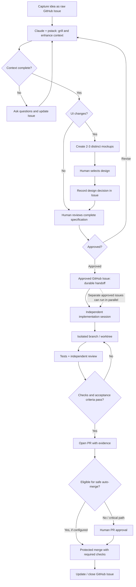

# Agent Workflow

A lightweight, local-first, issue-first AI development workflow built around **Claude Code**, **Codex**, **pstack**, and **GitHub**.

This repository defines repeatable workflows, handoff contracts, and project-level guardrails. It is **not** an agent runtime, a session daemon, or a replacement for [pstack](https://github.com/no-session/pstack).

## Workflow



> **Current status:** This is the *target workflow*, not an automatically enforced state machine. Docs-only auto-merge is not enabled by this repository. Human approval and GitHub branch protections remain required where applicable.

A new implementation session should be able to start from an **approved issue** without access to the planning conversation. GitHub Issues and PRs are the durable handoff; chat history is not.

## Getting started

**Global setup (once per computer):**

```bash
git clone https://github.com/JosephT5566/agent-workflow.git ~/dev/agent-workflow
cd ~/dev/agent-workflow
python3 setup.py doctor
python3 setup.py global
```

Global setup links our own skills into `~/.agents/skills`. It **does not silently install pstack**, change Claude/Codex permissions, or overwrite existing skill directories. See [pstack integration](integrations/pstack/README.md) for the official upstream installation.

**Project setup (once per repo, rerunnable):**

```bash
python3 ~/dev/agent-workflow/setup.py project --path ~/dev/my-project
```

Run `python3 setup.py doctor` to check dependencies. Agent-assisted installation is encouraged: ask your agent to read [AGENTS.md](AGENTS.md) first and review proposed file changes.

## Responsibilities

| Location | Responsibility |
| --- | --- |
| This repository | Reusable workflow instructions, skills, templates, setup script, safe defaults |
| Computer | Installed agents/pstack, symlinks, credentials, session runtime and worktrees |
| Each project repository | Project rules, validation commands, design references, review/merge policy |
| GitHub Issues and PRs | Requirements, decisions, approval, dependencies, task status, reviews |

## Operating principles

- **Issue before implementation:** raw ideas can be captured freely; only approved, complete issues may be implemented.
- **Grill and enhance:** resolve ambiguity; summarize answers, decisions, acceptance criteria, risks and out-of-scope items back into the issue.
- **Design before UI code:** for any UI change, produce multiple meaningfully different mockups and obtain explicit human selection.
- **Parallel by default when safe:** separate worktrees/branches; coordinate dependencies and overlapping files.
- **Review before merge:** CI and human approval for critical changes. Docs-only auto-merge is *not enabled by this repo*.
- **Local-first, no daemon:** agents execute instructions; setup configures the environment, not ongoing sessions.
- **Safe installation:** no secret commits, no silent overwrites, no automatic high-risk permissions.

## Documentation

- [Agent operating instructions](AGENTS.md)
- [Capture and enhance an issue](workflows/issue-enhance.md)
- [UI design approval](workflows/ui-design.md)
- [Independent implementation](workflows/implement.md)
- [Review and merge](workflows/review.md)
- [pstack integration](integrations/pstack/README.md)
- [Project config template](templates/project-config.yaml)

## Status

**v0 starter scaffold.** Workflows are written for agents to follow; end-to-end orchestration and automatic merging are deliberately not implemented yet. The initial `setup.py` provides repeatable setup and checks only.
